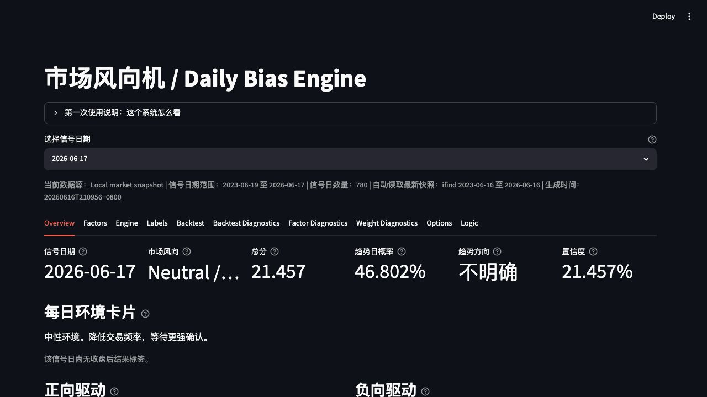
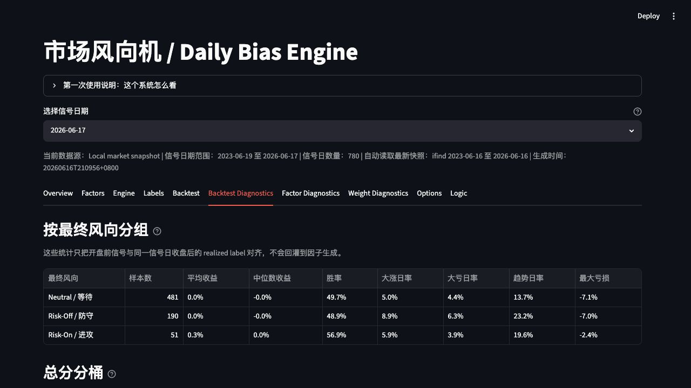
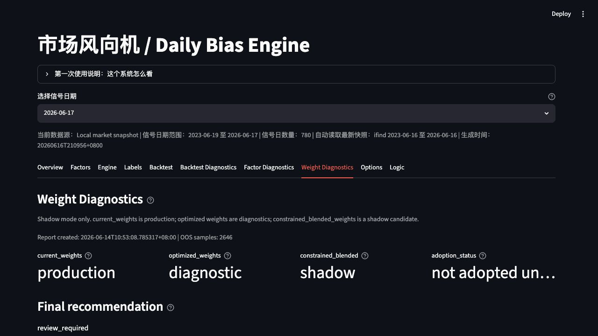
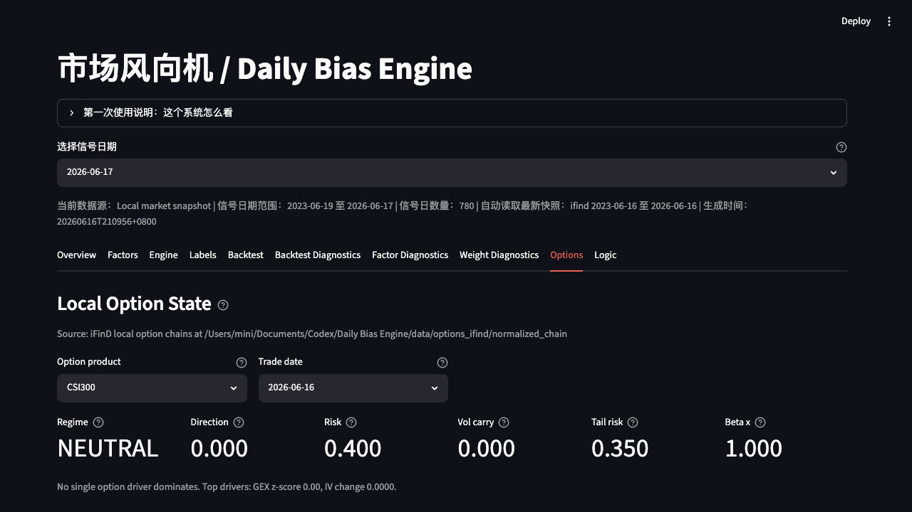

# Daily Bias Engine

Daily Bias Engine 是一个面向 A 股指数环境判断的盘前市场风向系统。它把本地化的 Wind 行情、利率、ETF、期货、海外市场和期权链数据整理成可审计的因子，再输出 `Risk-On / Neutral / Risk-Off` 市场偏向、趋势强度分、风险硬标记和回测诊断。

项目定位不是自动交易系统，而是一个研究型市场环境过滤器。它适合放在个人页面或项目作品集中展示：数据工程、因子工程、规则引擎、回测评估、期权结构分析和 Streamlit 产品化界面。

## Highlights

- Snapshot-first 数据流：先在本地拉取并固化 Wind 快照，再由 pipeline 和 Streamlit 读取 Parquet 结果。
- 盘前防偷看设计：日收盘数据生成下一交易日信号，因子同时保留 `data_date` 和信号 `date`。
- 可解释规则引擎：总分采用 `-100` 到 `+100` 区间，并展示正向驱动、负向驱动和风险覆盖原因。
- 期权结构模块：支持本地期权链的 GEX、Vanna、Charm、IV term structure、skew 和 beta overlay 诊断。
- 研究诊断闭环：包含 backtest、factor diagnostics、score bucket、trend bucket 和权重优化 shadow report。
- Streamlit dashboard：面向日常复盘和项目展示的交互式界面。

## 历史界面截图

当前看板通过左侧导航切换研究页面。2026 年 11 月的回测复核与改进建议见使用手册第 17 节。[系统复核与改进顺序](USER_MANUAL.md#17-2026-11-23-系统复核与改进顺序)

### Overview



### Backtest Diagnostics



### Weight Diagnostics



### Options



## What The Dashboard Shows

`apps/streamlit_app.py` 是项目的主要展示入口。在左侧选择研究页面。

- Overview：最新信号、市场风向、总分、趋势强度分、信号强度分和驱动拆解。
- Factors：当前信号日使用的因子明细和全历史因子表。
- Engine：每日信号总览、分项分、风险硬标记和全部因子贡献。
- Labels：收盘后 realized label，用于评估盘前信号。
- Backtest：收盘到收盘及开盘到收盘命中率、始终中性基准、大亏日明确防守率和逐日复盘。
- Backtest Diagnostics：按风向、总分分桶和趋势强度分桶检查历史表现。
- Factor Diagnostics：逐因子检验方向收益关系、亏损识别能力和五分位表现。
- Weight Diagnostics：展示当前权重、优化权重和 constrained blended shadow 权重。
- Liquidity：展示独立的美元流动性面板，指标保留采集时的实际来源（包括 FRED 和 Yahoo）。此面板不参与风向评分。
- Options：展示本地 Wind 期权链衍生出的关键价位、敞口、波动率和偏度结构。
- 日内 GEX 结合期权成交方向与指数分钟线，显示上证 50、沪深 300 和中证 1000 的做市商 Gamma 倾向、样本覆盖和判断依据。
- Logic：说明因子到 directional score、总分和最终 bias 的计算逻辑。

## Architecture

```text
data/snapshots/         local Wind market snapshots
data/options_wind/      local Wind option-chain snapshots
configs/                instruments, thresholds, factor weights
src/daily_bias_engine/
  data/                 data clients, snapshot cache, Wind adapters
  features/             factor calculators and as-of logic
  engine/               rule-based Daily Bias Engine
  labeling/             realized market labels
  backtest/             metrics and diagnostics
  options/              option analytics, reports and backtests
  report/               summary helpers
apps/                   Streamlit dashboard
reports/                weight optimizer diagnostics
tests/                  pytest coverage
```

## Install

macOS

```bash
python3 -m venv .venv
source .venv/bin/activate
python -m pip install -e ".[test]"
```

Windows PowerShell

```powershell
py -3 -m venv .venv
.\.venv\Scripts\Activate.ps1
python -m pip install -e ".[test]"
```

## Run Streamlit Dashboard

```bash
python -m streamlit run apps/streamlit_app.py
```

The dashboard automatically loads the latest local Wind market snapshot under `data/snapshots/`. If no snapshot exists, run `python scripts/fetch_wind_snapshot.py` first.

## 日内 GEX 与交易台

在项目虚拟环境中运行以下命令，分别更新最新五分钟快照、启动本机只读接口。

```bash
python scripts/update_intraday_gex.py
python -m daily_bias_engine.desk_api --port 8507
```

采集端支持 `--product CSI300`、`--as-of 2026-11-23T14:55` 和盘中连续采集 `--watch`。看板通过左侧「日内 GEX」查看。交易台按 IH、IF、IM 读取对应的期权判断及全市场盘前风向。[接口契约、估计口径和接入步骤](docs/TRADING_DESK_INTEGRATION.md)

## Run Tests

```bash
pytest
```

## 本地 Wind 更新

在装有官方 Wind API 的机器上登录。macOS 使用 Wind API.app，Windows 使用 Wind 终端安装的 64 位 Python SDK。项目读取虚拟环境中的 `WindPy.pth`。自定义 SDK 路径时，可给配置脚本传 `--wind-python-dir`，指向包含 `WindPy.py` 的目录。

在项目目录使用虚拟环境运行以下命令。macOS 示例为

```bash
.venv/bin/python scripts/configure_wind.py
.venv/bin/python scripts/update_wind_data.py --dry-run
.venv/bin/python scripts/update_wind_data.py
.venv/bin/python -m streamlit run apps/streamlit_app.py
```

采集进程复用一个 WindPy 登录会话。与本机 Trading Desk 错开采集时段，Streamlit 可以同时打开并读取本地文件。

- **市场快照**首次拉取三年历史，包括指数、期货、ETF、海外市场和利率。后续按各序列最后一个有效观测日补齐数据。快照清单用 `source=wind` 识别来源。缺少当前品种的早期 Wind 快照会触发全量重建。
- **期权链**首次更新最近一个已收盘交易日的上证50、沪深300和中证1000，之后逐交易日增量更新。按需用 `--options-start YYYY-MM-DD` 补历史。数据写入 `data/options_wind/`。
- **收盘时间**默认截止日按北京时间 16:30 切换。单独重建市场数据或取某一天的期权链时，可分别运行以下命令。

```bash
python scripts/fetch_wind_snapshot.py --full-refresh --years 3
python scripts/fetch_wind_options_snapshot.py --date 2026-11-20 --product CSI300
python -m daily_bias_engine.options.reports.daily_option_state --date 2026-11-20 --product CSI300
```

旧 iFinD 实现、历史快照和更新说明保存在 `archive/ifind-idle` 分支（`fbf922b`）。主分支的日常更新只维护 Wind 数据，默认保留最近两份 Wind 市场快照。

## Weight Diagnostics

Generate a walk-forward factor weight diagnostic report without changing `configs/factor_weights.yaml`:

```bash
python -m daily_bias_engine.weight_optimizer --snapshot-root data/snapshots --config-dir configs --output-dir reports/weight_optimizer
```

The report writes fixed latest files for dashboard consumption:

- `reports/weight_optimizer/latest_weight_diagnostics.json`
- `reports/weight_optimizer/latest_weight_diagnostics.md`
- `reports/weight_optimizer/walk_forward_folds.csv`
- `reports/weight_optimizer/factor_stability.csv`
- `reports/weight_optimizer/bucket_analysis_return.csv`
- `reports/weight_optimizer/bucket_analysis_risk.csv`
- `reports/weight_optimizer/regime_factor_ic.csv`

## Documentation

- [USER_MANUAL.md](USER_MANUAL.md): Chinese user guide.
- [DATA_DICTIONARY.md](DATA_DICTIONARY.md): Dataset and field notes.
- [FACTOR_LOGIC.md](FACTOR_LOGIC.md): Factor construction logic.
- [SCORING_RULES.md](SCORING_RULES.md): Scoring and threshold details.
- [SPEC.md](SPEC.md): Project specification.

## Current Scope

- Implemented: Wind data fetching, Parquet cache, representative factors, score engine, labels, metrics, tests, Streamlit dashboard, option state layer and weight diagnostics.
- Not implemented yet: scheduler, database storage, execution integration or live broker connection.

## Disclaimer

This repository is for research and project demonstration only. The output is a market-environment signal, not investment advice or an order-generation system.
